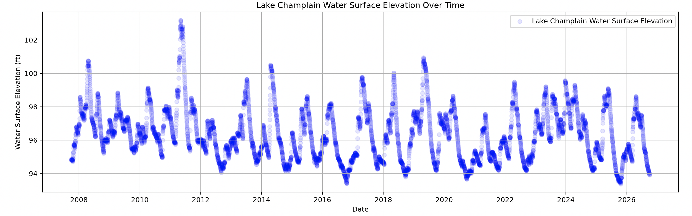
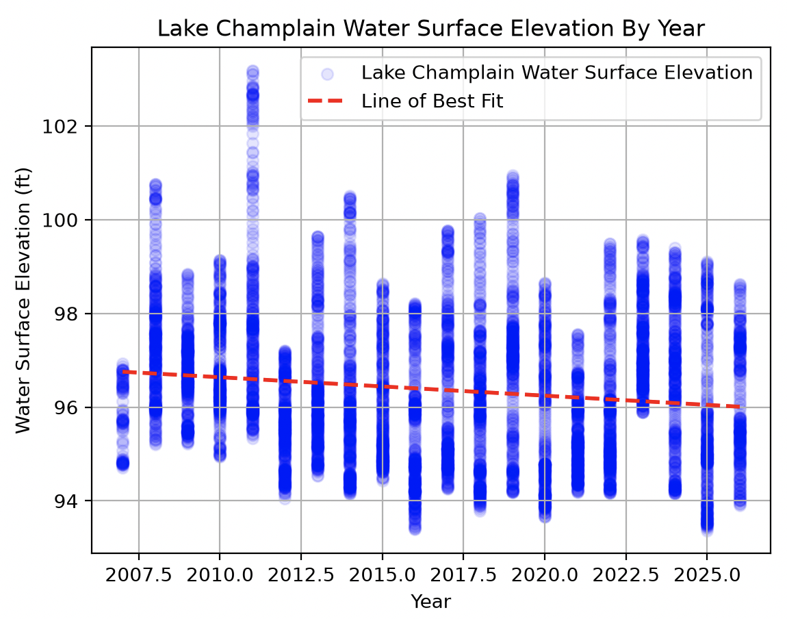
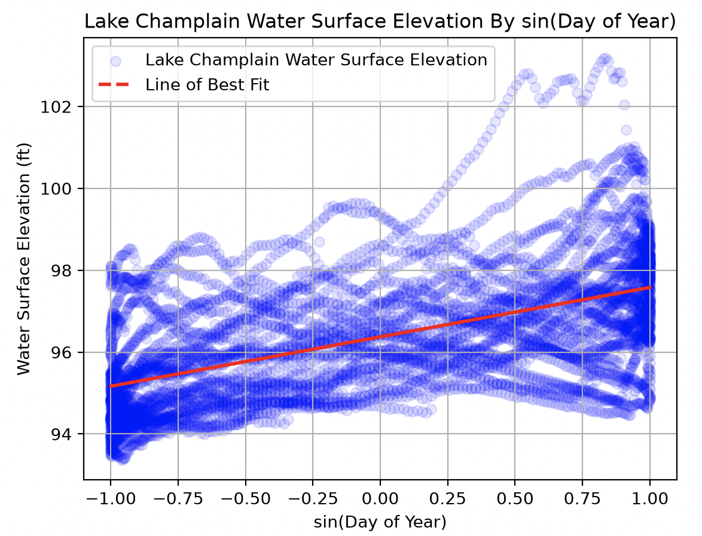
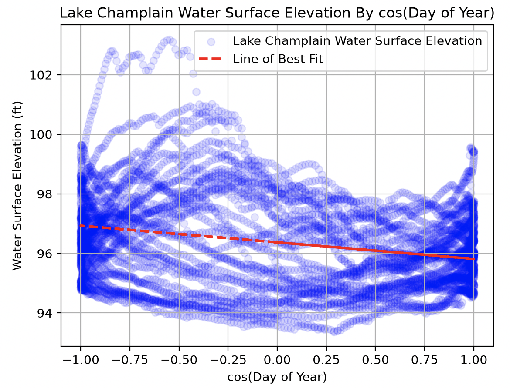
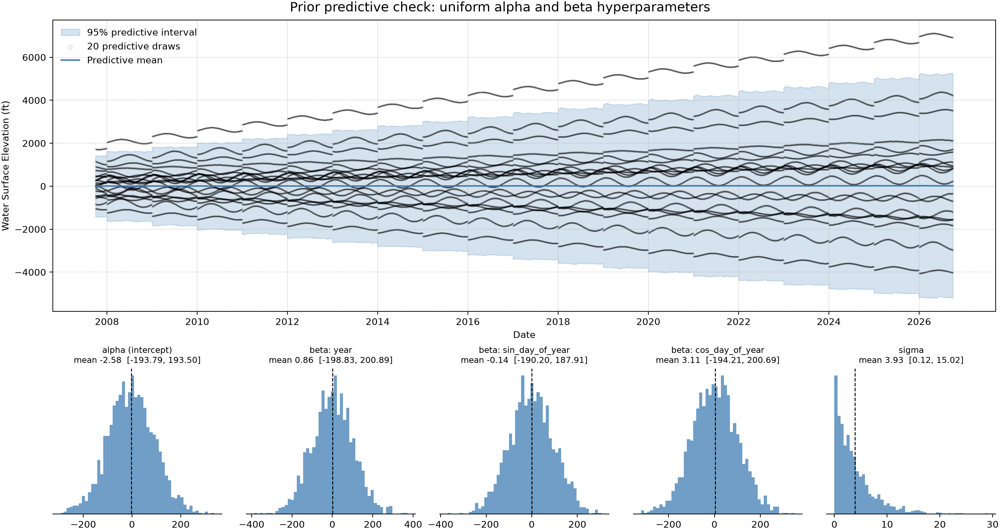
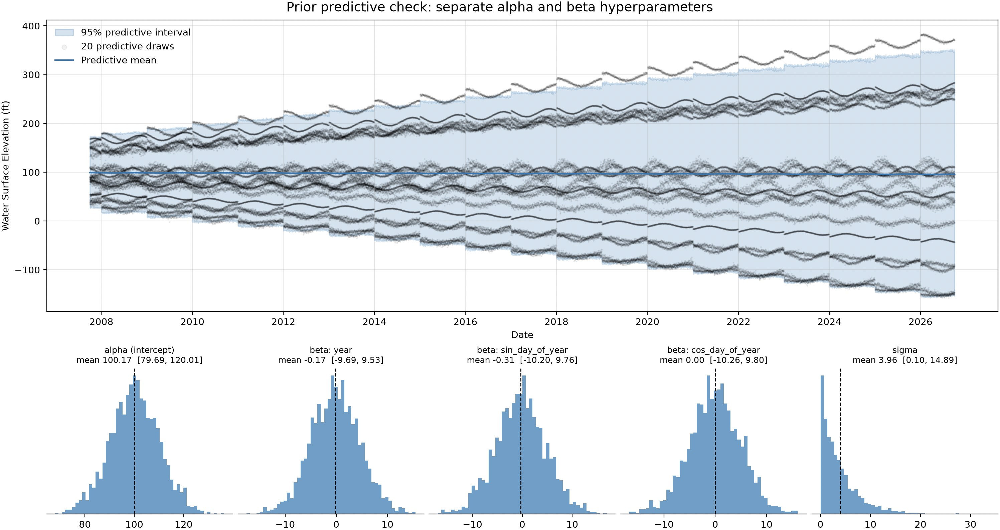
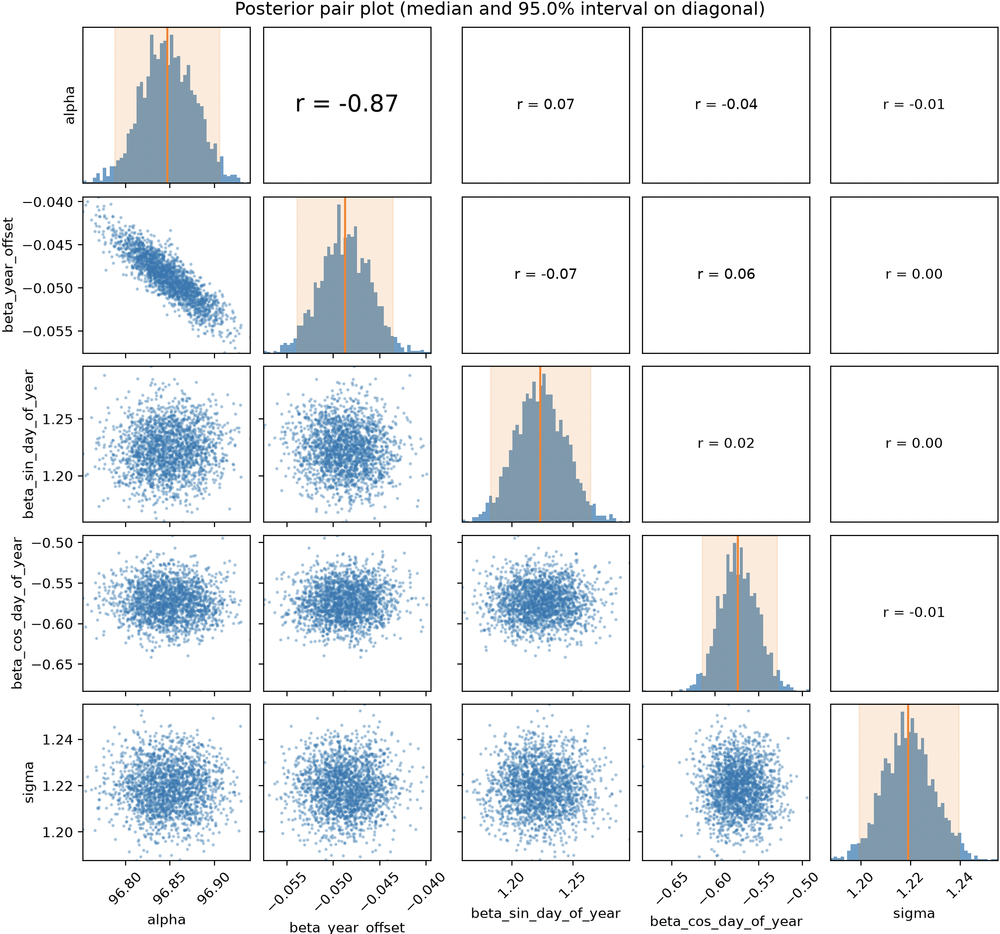
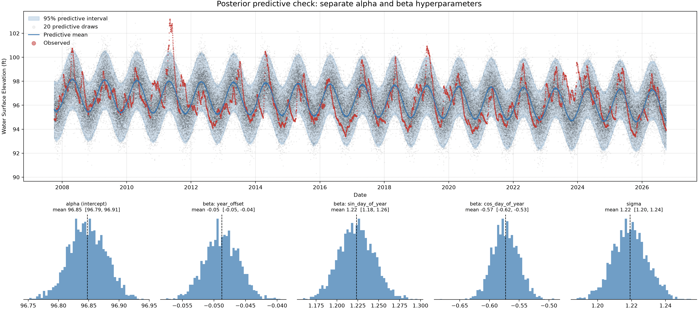

# Report - Josh Fishbein - HW 2

## 1. Data construction and description

### Data File

`raw.txt` contains 663,415 [USGS](https://waterdata.usgs.gov/nwis/uv?site_no=04294500&legacy=1) water level measurements at 15min increments from Lake Champlain between October 1, 2007 and Oct 2, 2026. Each observational unit is a timestamp with an associated lake elevation measurement in feet.

### Constructing the observations

To convert raw data into variables for our model, 15min data were rescaled to daily by averaging observations across the day. The response variable was filtered to only use data obtained via the older NGVD29 measurement approach which contains measurements for the full observational period. The "year_offset" predictor is the year component of the observation date since 2007 - the first observation year - so that it is a more similar order of magnitude to the other predictors and to make the intercept term more interpretable. The "sin_day_of_year" and "cos_day_of_year" features were obtained by rescaling the day of year for the observation date to an interval within $[0, 2\pi]$ and taking the sin and cos respectively. This sine and cosine transformation on the day of year enables fitting a linear model to periodic data. By transforming the day of year predictor to have both sine and cosine wave forms with yearly periods, the model can fit parameters that capture the seasonal dynamics with an estimated amplitude and phase shift.

  

  

  

  

## 2. Modeling question

How are water levels for Lake Champlain changing over time?

As a Burlington resident, the health of Lake Champlain is important to me from both an ecological and recreational perspective. Empirically, water levels seem to be getting lower every year which has made me wonder if and how water levels are changing. Using a bayesian linear model, we can model how lake levels are changing throughout time and can use our model to generate a range of future scenarios for lake conditions that could be of use to policymakers and/or ecologists.

## 3. Model description

### Likelihood

**Annual Model** (one observation per complete year, $y = 1, \dots, 18$)

$\bar{Y}_y \mid \alpha, \beta, \sigma \sim Normal(\mu_y, \sigma)$\
$\mu_y = \alpha + \beta \cdot \text{year\_offset}_y$

where $\bar{Y}_y$ is the mean water surface elevation in year $y$ and $\text{year\_offset}_y$ is the number of years since 2008.

**Harmonic Model** (one observation per day, $i = 1, \dots, N$)

$Y_i - \bar{Y}_{y[i]} \mid \alpha, \vec{\beta}, \sigma \sim Normal(\mu_i, \sigma)$\
$\mu_i = \alpha + \beta_1 \sin(t_i) + \beta_2 \cos(t_i) + \beta_3 \sin(2t_i) + \beta_4 \cos(2t_i) + \beta_5 \sin(3t_i) + \beta_6 \cos(3t_i)$\
$t_i = 2\pi \cdot \frac{\text{day\_of\_year}_i - 1}{365.25}$

where $Y_i - \bar{Y}_{y[i]}$ is day $i$'s elevation minus the mean elevation of its year.

### Priors

**Annual Model**

$\alpha \sim Normal(\mu=96.5, \sigma=2)$\
$\beta \sim Normal(\mu=0, \sigma=0.1)$\
$\sigma \sim Exponential(\beta=1)$

**Harmonic Model**

$\alpha \sim Normal(\mu=0, \sigma=1)$\
$\vec{\beta} \sim Normal(\mu=0, \sigma=5)$\
$\sigma \sim Exponential(\beta=0.25)$

## 4. Prior-predictive analysis

Initially, I tried putting $\alpha$ in my design matrix using a vector of ones. This required me to use the same priors for all $\alpha, \beta$ that were far too broad for the domain. The following priors are depicted in the plot below and can be seen to cover a wildly infeasible range of water surface elevations:

$\alpha \sim Normal(0, 100)$\
$\beta \sim Normal(0, 100)$\
$\sigma \sim Exponential(0.25)$

  

After splitting $\alpha$ out as a separate independent prior, I used the updated priors which much more closely represent the domain. These priors are reasonable as they produce more plausible lake levels (apart from the negative values near the end) - there is no strong reason to believe the $\alpha, \beta$ priors would not be normally distributed, the $\alpha$ mean is roughly around the elevation of Lake Champlain, and all $\sigma$ values provide a reasonable level of model tolerance. The $\beta$ prior is a bit too large for the coefficient for yearly water level changes (which is why the uncertainty gets so large by the end of our time horizon), but it's not egregiously so and means that we don't need separate priors for every $\beta$ coefficient.

$\alpha \sim Normal(100, 10)$\
$\beta \sim Normal(0, 5)$\
$\sigma \sim Exponential(0.25)$

  

## 5. Estimation

The final model was generated using the following priors. Stan reported no warnings.

$\alpha \sim Normal(100, 10)$\
$\beta \sim Normal(0, 5)$\
$\sigma \sim Exponential(0.25)$

  

| Parameter | Median | p2.5 | p97.5 |
|---|---:|---:|---:|
| alpha | 96.85 | 96.79 | 96.91 |
| beta_year_offset | -0.049 | -0.054 | -0.044 |
| beta_sin_day_of_year | 1.22 | 1.18 | 1.26 |
| beta_cos_day_of_year | -0.57 | -0.62 | -0.53 |
| sigma | 1.22 | 1.20 | 1.24 |

## 6. Posterior predictive check

  

The posterior predictive simulations have reasonable agreement with the observed dataset: the simulations reasonably capture both the periodic nature of Lake Champlain water levels as well as the small year-over-year decline in water levels. However, there are a few significant disagreements: (1) the model only captures the predominant yearly cycle in water levels, even though there appear to be other cycles at play (in the real world, for example, this may be impacts of El Nino/La Nina cycles) and (2) the model simulations fail to capture the significant spikes that occur in the observed data.

## 7. Interpretation

- $\alpha$, the intercept has a mean of 96.85ft and corresponds to the 2007 Lake Champlain water surface elevation when sin=0 and cos=0 (the 2007 annual average). Because sin and cos are annual periodic cycles with a mean of zero, the intercept represents the mean water level for the annual period.
- $\beta_0$, the regression coefficient for the year offset has a mean of -0.049ft/year, meaning that each year the annual average lake water surface elevation drops 0.049ft assuming all other variables are held constant.
- $\beta_1$, the regression coefficient for the sine-transformed day of year has a mean value of 1.22. This means that the water surface elevation changes by 1.22 times the sine of the day of year assuming all other variables are held constant. Essentially, it relates the water level to a yearly periodicity that follows the sine with 1.22ft amplitude.
- $\beta_2$, the regression coefficient for the cosine-transformed day of year has a mean value of -0.57. Taken together with the sine-transformed day of year, the two parameters define the yearly periodic phase shift and amplitude for how much the water surface elevation is changing day to day. Specifically, the water surface elevation in feet follows a sine wave where the period is 1 year, the amplitude is 1.35, and the phase shift is -0.44 radians.
- $\sigma$, the residual standard deviation has a mean of 1.22ft which means that ~$\frac{2}{3}$ of the observed values fall within $\pm$ 1.22ft of the regression mean.

Some takeaways from these statistics: (1) the model estimates a slow decline in water levels over the last ~20 years given the negative association between year and water level. However, because consecutive daily observations are not independent, the 95% credible interval around this regression coefficient is likely far narrower than it should be. (2) Water levels are clearly periodic on a yearly cycle given the amplitude of our wave, however, there is also a lot of uncertainty in these daily predictions - the size of our standard deviation is almost the same size as our wave amplitude.

## 8. Self-assessment

There are two things I am most unsure about:
1) What is the standard approach when different $\beta$ have different priors? For example the coefficient for the yearly trend should have a much smaller coefficient than the intra-yearly variation. Is it standard to have separate priors for all $\alpha$ and $\beta$, to choose a broad prior that covers everything, or something in between?
2) Is the approach I took using sine and cosine transformations to fit periodic data to a linear model reasonable? From the plots it appears to have worked, but is this how scientists would typically choose to model periodic data using bayesian models?

This assignment took me 10-15 hours.

## 9. Declarations of AI Use

Claude helped me with significant code writing for the plots and visualizations. Additionally, I collaborated with it on a high level design for using sine and cosine transformations on the day of year to capture yearly periodicity. Lastly, Claude helped review my work and flag areas I went astray. I took the following precautions to ensure correctness (or if incorrectness, at least that it was my own work). (1) I instructed Claude not to rewrite any of my text, but just flag areas that it disagrees with. (2) When Claude proposed something non-intuitive, I worked with it to have it thoroughly explain itself before incorporating its proposals. Afterward, I made sure to independently validate its work. For example, it proposed a much more involved approach to capturing the seasonal dynamics of water levels, but I opted to only use sine and cosine components as this was all I could easily understand and verify on my own.